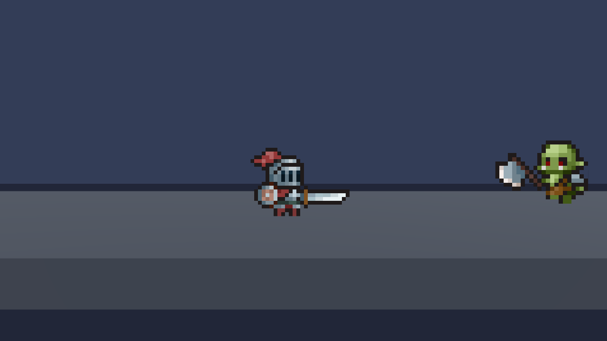

# Bond Brawler

2.5D 横版清版动作游戏的**工业级骨架**（Castle Crashers 式：横轴推进 + 浅纵深走位 + 同屏群战）。
Godot 4.7 / GDScript。领域驱动 + 六边形架构，战斗逻辑可脱离引擎单测与回放。



## 快速开始

> 仓库**不包含** `data/` 与 `assets/sprites/`（版权原因，见下节）。
> 只想读代码 / 跑单元测试可以直接用；要跑起画面需先按「数据与素材」准备好这两份。

```powershell
# 1. 打开工程（首次会导入资源）
& "D:\Godot\4.7.1\Godot_v4.7.1-stable_win64.exe" --path .

# 2. 跑测试（headless，无需界面）
bash tools/test.sh

# 3. 架构约束检查
python -I tools/check_architecture.py
```

## 数据与素材（不随仓库分发）

| 目录 | 来源 | 为什么不提交 |
|---|---|---|
| `data/` | 《宝可梦羁绊之旅》1.0.0 解包还原的数值 | 宝可梦相关权利归原权利人，原包标注「仅供学习研究」 |
| `assets/sprites/` | Tiny RPG Character Asset Pack v1.03 | 素材包内无 license 文件，再分发条款不明 |

本地自备方法：

```bash
# 1. 数值：把解包得到的 JSON 放进 data/
#    字段说明见 docs/data-schema.md，需要 6 个文件：
#    skills.json / species.json / type_chart.json / actions.json / combat_params.json / movement.json

# 2. 角色图集：从素材包重建（20 个角色，100x100 帧）
python tools/build_asset_manifest.py "<素材包>/Characters(100x100)" assets/sprites/characters
python tools/normalize_sprites.py        # 裁剪 + 统一比例与锚点
python -I tools/gen_asset_spec.py        # 重新生成 ASSET_SPEC.md
```

缺数据时组合根会降级运行（`push_warning` + 默认值），不会崩溃；但角色没有贴图、技能表为空。

## 目录

```
src/
  core/            共享内核：事件总线、端口、平面几何、常量、确定性随机
  combat/domain/   属性、修改器、状态、伤害管线
  skills/domain/   技能定义、冷却、相位、效果器
  talents/domain/  天赋 DAG、洗点、快照
  ai/domain/       效用 AI、黑板、意图
  locomotion/domain/ 动作状态机、输入缓冲、土狼时间、霸体
  stage/domain/    波次生成、房间进度、存档快照
  application/     用例编排（BattleSession / ActorRuntime）
  infrastructure/  JSON 仓库、时钟、随机、存档
  presentation/    CharacterBody3D 视图、打击感、对象池、相机
  bootstrap/       组合根
data/              （不提交）数值：124 技能 / 221 种族 / 属性克制
assets/sprites/    （不提交）角色图集，20 个角色 100x100 帧
tests/             GdUnit4 单元测试 + 领域端到端 + 场景端到端
tools/             测试执行器、素材清单生成、架构检查
docs/              架构契约、编码规范、ADR
```

## 核心设计

1. **领域层零引擎依赖**：所有战斗规则是纯 `RefCounted` 类，`godot --headless` 秒级测试。
   见 [ADR-0001](docs/adr/0001-hexagonal-architecture.md)。
2. **命中判定两段式**：`Area3D` 只做宽相，领域层做窄相并产生全部伤害数字。
   见 [ADR-0002](docs/adr/0002-two-phase-hit-detection.md)。
3. **平面坐标**：`Vector2(x, lane)` + 独立高度标量，纵深判定只需一行。
   见 [ADR-0003](docs/adr/0003-plane-coordinates.md)。
4. **数据驱动**：技能、种族、属性克制全部来自 `data/*.json`，改数值不用改代码。

## 操作

| 键 | 动作 |
|---|---|
| A / D | 左右移动 |
| W / S | 纵深走位 |
| J | 攻击（3 段连击） |
| K | 跳跃（可变高度） |
| L | 冲刺（前 0.18s 无敌） |
| U / I / O / P | 技能 1~4 |
| 空格 | 格挡 |

## 当前状态

**可运行**。`295` 个测试（GdUnit4，44 个 suite）全绿，架构检查通过。

已打通：组合根装配 → 玩家 + 3 个敌人 → 动作状态机（输入缓冲/土狼时间/可变跳跃/冲刺无敌/霸体）
→ 技能相位与效果器 → 窄相命中判定 → 伤害管线（闪避/格挡/暴击/属性克制/防御减免）
→ 打击感反馈（顿帧/震屏/闪白/跳字）→ 波次与存档快照。

美术与关卡仍是程序化占位；数据接的是真实的 124 技能 / 221 种族。

## 工具

| 命令 | 作用 |
|---|---|
| `bash tools/test.sh [路径...]` | 跑 GdUnit4 测试，带目录锁可并发 |
| `python -I tools/check_architecture.py` | 架构约束检查 |
| `python -I tools/lint_gdscript.py` | GDScript 静态检查（未用参数/变量遮蔽等） |
| `python tools/normalize_sprites.py` | 素材归一化（裁剪 + 统一比例与锚点） |
| `python -I tools/gen_asset_spec.py` | 重新生成 ASSET_SPEC.md |
| `godot --headless --path . --script res://tools/sim_check.gd` | 无界面跑一段对局并打印状态 |
| `godot --path . --script res://tools/capture.gd` | 截一张运行画面 |

## 许可

代码为本项目原创。测试框架为 [GdUnit4](https://github.com/MikeSchulze/gdUnit4)（MIT，见 `addons/gdUnit4/LICENSE`）。
`data/` 来自《宝可梦羁绊之旅》的数值还原，仅供学习研究，宝可梦相关权利归原权利人；
角色图集来自 Tiny RPG Character Asset Pack，遵循其原始许可。
**这两者都不随本仓库分发**，见「数据与素材」一节。
